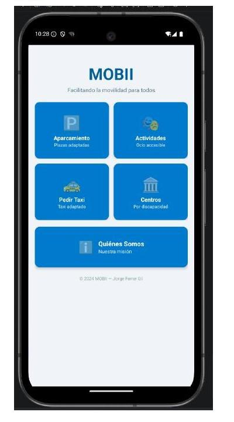
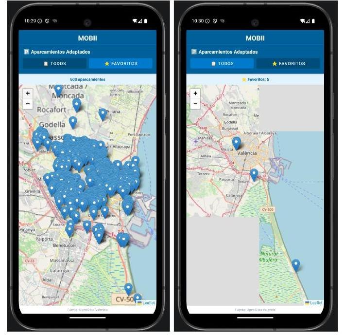
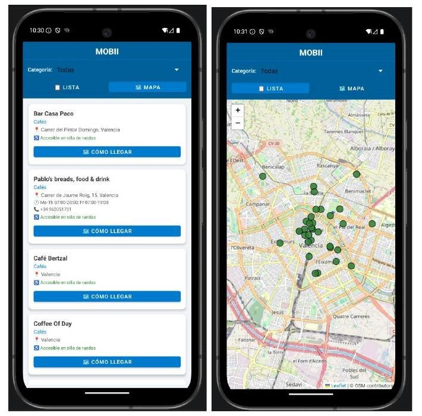
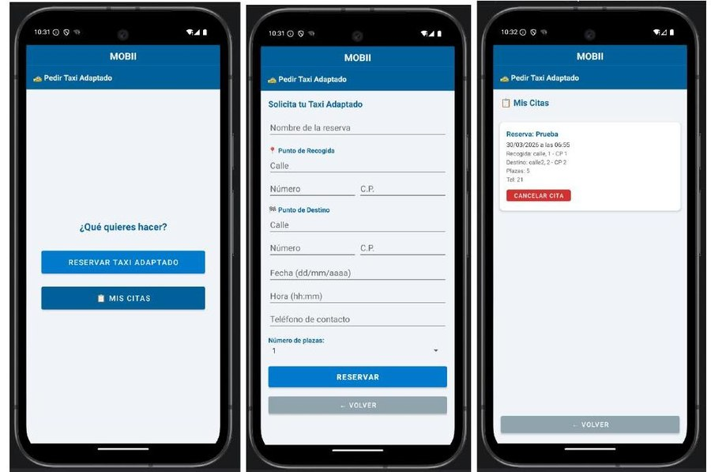
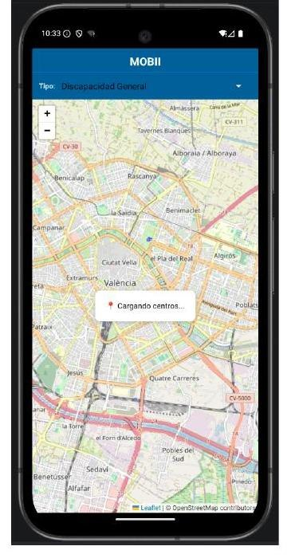
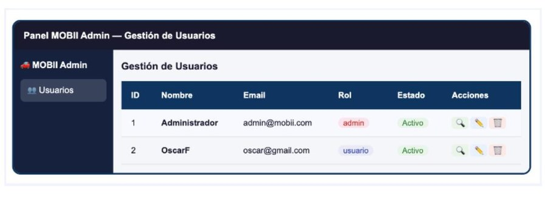

# MOBII — Movilidad accesible para todos

Sistema completo de tres capas para que las personas con movilidad reducida encuentren **aparcamiento adaptado**, reserven **taxi accesible** y localicen **centros especializados** y **actividades de ocio accesibles** en Valencia, todo desde una sola app.

Proyecto de Fin de Ciclo del Grado Superior en Desarrollo de Aplicaciones Multiplataforma (DAM), diseñado y desarrollado en solitario por **Jorge Ferrer Gil** (2026).

[Portafolio](https://ferrerversion.github.io/FerrerVersion/proyectos/mobii/) · [Memoria técnica (PDF)](https://ferrerversion.github.io/FerrerVersion/assets/files/MOBII_Memoria_JorgeFerrer.pdf) · [LinkedIn](https://www.linkedin.com/in/jorge-ferrer-gil-5008b423a/)

| Inicio | Aparcamientos | Actividades |
|---|---|---|
|  |  |  |

| Taxi adaptado | Centros especializados | Panel de administración |
|---|---|---|
|  |  |  |

## El problema

La información sobre aparcamientos adaptados, taxis accesibles o centros preparados existe, pero está repartida en webs distintas que casi nunca funcionan bien desde el móvil. Ninguna app (ni Google Maps, ni las de parking, ni Cabify Assist) la reúne en un solo sitio.

## Qué hace

- **Mapa de aparcamientos adaptados** con datos reales del Open Data del Ayuntamiento de Valencia y del Geoportal ArcGIS municipal, con favoritos.
- **Reserva de taxi adaptado** con formulario y listado de reservas.
- **Directorio de centros especializados** filtrado por tipo de discapacidad.
- **Actividades de ocio accesible** en lista y en mapa.
- **Cuenta de usuario** (registro, inicio de sesión y perfil) con favoritos y reservas sincronizados con la API propia.
- **Funciona sin conexión**: copia local de favoritos y reservas con ORMLite.
- **Modo oscuro**.
- **Panel web de administración** para gestionar usuarios y consultar sus favoritos y reservas.

## Arquitectura

```
┌──────────────────────┐        REST + JWT        ┌──────────────────────┐
│   App Android (Java) │ ───────────────────────► │  API REST (Node.js)  │
│  Retrofit · ORMLite  │                          │  Express · bcrypt    │
│  Leaflet en WebView  │                          │  JWT · SQLite        │
└──────────┬───────────┘                          └──────────▲───────────┘
           │                                                 │ REST + JWT (rol admin)
           │ HTTPS                                ┌──────────┴───────────┐
           ▼                                      │ Panel admin (Angular)│
  Open Data Valencia / ArcGIS                     │  TypeScript · RxJS   │
  (aparcamientos y actividades)                   └──────────────────────┘
```

Tres capas independientes conectadas por API REST, de forma que cualquiera de ellas se puede cambiar sin tocar las demás. La app consulta directamente los datos abiertos del Ayuntamiento y usa la API propia para la autenticación y la sincronización.

| Carpeta | Tecnologías |
|---|---|
| [`android/`](android) | Java, Android SDK (API 24+), Retrofit, Gson, ORMLite, Glide, Material Design, Leaflet.js en WebView |
| [`backend/`](backend) | Node.js, Express, better-sqlite3, bcryptjs, jsonwebtoken |
| [`admin-panel/`](admin-panel) | Angular, TypeScript, RxJS, formularios reactivos |

### Endpoints de la API

| Método | Ruta | Descripción |
|---|---|---|
| POST | `/api/auth/register` | Registro (contraseña con hash bcrypt) |
| POST | `/api/auth/login` | Inicio de sesión, devuelve un JWT |
| GET / PUT | `/api/auth/perfil` | Ver y editar el perfil propio |
| DELETE | `/api/auth/cuenta` | Borrar la cuenta propia |
| POST / DELETE | `/api/sync/favoritos` | Sincronizar aparcamientos favoritos |
| POST / DELETE | `/api/sync/reservas` | Sincronizar reservas de taxi |
| GET / POST / PUT / DELETE | `/api/usuarios` | Gestión de usuarios (solo rol admin) |

## Cómo ejecutarlo

Requisitos: Node.js 20+, Android Studio con JDK 17 y un emulador o móvil con Android 7.0 o superior.

**1. API**

```bash
cd backend
npm install
JWT_SECRET="cambia-esta-clave" npm start      # http://localhost:3000
```

Al arrancar por primera vez crea la base de datos SQLite y un usuario administrador **solo para desarrollo** (`admin@mobii.com` / `admin123`). Si no se define `JWT_SECRET`, el servidor genera una clave temporal al arrancar.

**2. Panel de administración**

```bash
cd admin-panel
npm install
npx ng serve                                  # http://localhost:4200
```

**3. App Android**

Abre la carpeta `android/` con Android Studio y ejecuta la app en un emulador. La app se conecta a la API en `http://10.0.2.2:3000`, que es la dirección del ordenador visto desde el emulador de Android. Para un móvil físico, cambia `BASE_URL` en `auth/AuthRetrofitClient.java` por la IP del ordenador.

## Retos que resolví

- **Mapa de Leaflet dentro de un WebView**: hubo que comunicar JavaScript y Java con `@JavascriptInterface` y resolver varios errores de CORS, moviendo finalmente todas las peticiones HTTP al lado Java.
- **Cambio de versión de la API de Open Data Valencia**: a mitad del proyecto el portal migró a la versión 2.1, lo que rompió las peticiones existentes y obligó a adaptar el cliente HTTP al nuevo formato.
- **Funcionamiento sin conexión**: ORMLite guarda una copia local de favoritos y reservas para que la app siga siendo útil sin internet.

## Qué mejoraría

- La sincronización sin conexión es la parte más frágil: una versión real necesitaría una cola de cambios pendientes que se envíe al recuperar la conexión.
- Servir la API por HTTPS y quitar `usesCleartextTraffic`, que ahora solo está para poder probar en local.
- Añadir tests automáticos a la API y a la app.

## Autor

**Jorge Ferrer Gil**, desarrollador de aplicaciones multiplataforma.
[Portafolio](https://ferrerversion.github.io/FerrerVersion/) · [LinkedIn](https://www.linkedin.com/in/jorge-ferrer-gil-5008b423a/) · ferrerversion@gmail.com
